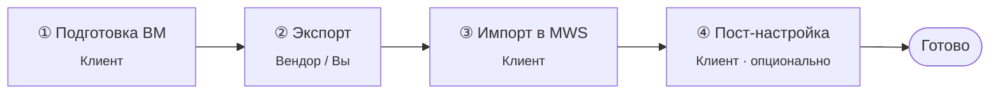

Toolkit для миграции виртуальных машин Windows и Linux из окружения VMware или других облачных провайдеров в MWS Cloud Platform (KVM).

---

## Зачем это нужно

MWS Cloud Platform – открытая облачная платформа на базе KVM. Без платы за гипервизор и лицензии, без переподписки.

`migration-to-mws` переносит уже работающую ВМ из вашей текущей VMware-инфраструктуры в MWS в тех случаях, когда переустановка ОС невозможна.

MWS не имеет доступа к вашей исходной инфраструктуре. Экспорт, выгрузка и загрузка в объектное хранилище выполняются вами или вашим текущим провайдером.

---

## Стратегии переезда

Прежде чем брать toolkit, ответьте на один вопрос: нужно ли сохранить ОС как есть? В большинстве случаев ответ «нет». Разберём три подхода.

### A. Чистая установка + перенос данных (рекомендуется)

Развернуть свежую ВМ из каталога образов MWS, описать провижининг (cloud-init / CloudBase-Init, Ansible, DSC), перенести данные.

Почему это правильная стратегия:

- ОС независима от исходной инфраструктуры. Контур описывается кодом, а не вики-страницей «тут в 2018-м что-то правили руками».
- Никакого legacy: старых драйверов, забытых сервисов, накопленных GPO.
- Активация, KMS, мониторинг, бэкапы – штатно, без поиска причин сбоев.
- Воспроизводимость: вторую такую же ВМ вы поднимете из того же кода.

Цена: переустановка приложений и перенос конфигов. Обычно это самый долгий этап, но и самый долговечный.

### B. In-Place Upgrade + миграция

Обновить ОС «поверх» до актуальной версии, затем мигрировать обновлённую систему.

Имеет смысл, когда ОС старая и не поддерживается, приложения переустанавливать нельзя, но In-Place Upgrade возможен. Для Windows – ссылки Microsoft ниже; для Linux – обновление дистрибутива до поддерживаемого.

Компромисс: багаж вы всё ещё тащите, но хотя бы не из 2008 года.

### C. Прямая миграция «как есть» (этот toolkit)

Перенос ВМ без переустановки ОС и приложений. Toolkit готовит систему к экспорту из вашего гипервизора и загрузке в KVM: MBR→GPT, VirtIO, загрузчик, devnode.

Этот сценарий существует для случаев, когда A и B действительно не работают.

Когда он оправдан:

- Кастомные сборки, которые не обновить. Нет провижининга, тащите сборку дальше.
- Приложения, привязанные к состоянию ОС. SID, локальные сертификаты, COM+, привязка лицензий к железу. После смены железа это может сломаться само по себе. Toolkit даёт системе загрузиться, но не гарантирует, что приложение заработает.
- Лицензионные ограничения. OEM-лицензия, привязка к железу. После смены гипервизора активация отвалится в любом случае из-за смены всех компонент оборудования.
- Legacy-нагрузка. Система, которую нельзя ни обновить, ни переустановить, ни выбросить. Она должна работать ровно так, как работала. Дорого, страшно, но иногда единственный путь.

Когда не стоит:

- Массовая миграция. Для сотен ВМ есть Hystax Acura, Carbonite Migrate и другие коммерческие V2V с непрерывной репликацией. Toolkit не конкурент им. Он для единичных ВМ.
- Большие данные. Терабайты не причина тащить ОС целиком. Подключите диск с данными отдельно и перенесите их как дамп в новую ВМ.

---

## Поддерживаемые ОС

| Платформа | Версии |
|---|---|
| Windows Server | 2019 / 2022 / 2025 |
| Windows | 10 / 11 (ограниченное тестирование) |
| Linux: Debian-like | Debian 11+, Ubuntu 20.04+, Mint 21+ |
| Linux: RHEL-like | RHEL 8+, Rocky 8+, Alma 8+, Fedora 35+, Oracle 8+ |

Не поддерживается: Windows Server 2016/2012 (нет `mbr2gpt.exe`), CentOS 6/7, RHEL 6/7, Debian 10 (EOL).

### Если ваша версия Windows не поддерживается

**In-Place Upgrade.** Обновление «поверх» с сохранением ролей и данных. Выполняется на исходной ВМ до миграции. Материалы Microsoft:

- [Windows Server Upgrade Center](http://aka.ms/upgradecenter)
- [Install | Upgrade | Migrate to Windows Server 2019](https://learn.microsoft.com/en-us/windows-server/get-started/install-upgrade-migrate-19)

**Чистая установка в KVM.** Разверните актуальную версию из каталога образов MWS, перенесите данные и приложения.

### Если ваша версия Linux не поддерживается

Либо обновите дистрибутив до поддерживаемого, либо разверните чистую ВМ в KVM и перенесите данные.

---

## Структура репозитория

```
migration-to-mws/
├── README.md
├── 0-Документ-клиенту-Windows.md
├── 0-Документ-клиенту-Linux.md
│
├── windows/
│   ├── 1-run.bat
│   ├── 2-Orchestrator.ps1
│   ├── 3-Diagnostic.ps1
│   ├── 4-Migration.ps1
│   ├── 5-Post-Migration.ps1
│   ├── 6-CloudBase-Init.ps1
│   ├── 7-Sysprep.ps1
│   ├── configs-cloudbase-init/
│   ├── tools/
│   └── logs/
│
└── linux/
    ├── 1-run.sh
    ├── 2-Orchestrator.sh
    ├── 3-Diagnostic.sh
    ├── 4-Migration.sh
    ├── 5-Post-Migration.sh
    ├── 6-Cloud-Init.sh
    ├── 7-Sysprep.sh
    ├── lib-core.sh
    ├── lib-steps-boot.sh
    ├── lib-steps-runtime.sh
    ├── configs-cloud-init/
    └── logs/
```

---

## Как проходит миграция



---

## Требования к диску

- Максимальный размер диска — 16 ТБ.
- Максимум дисков на ВМ — 64.
- Не поддерживается: активный BitLocker, динамические диски Windows, больше 4 primary-разделов в MBR.

---

## Форматы образов

| Формат               | Когда использовать                                             |
| -------------------- | -------------------------------------------------------------- |
| qcow2                | Предпочтительный. Поддерживает сжатие                          |
| vmdk                 | Если исходная ВМ уже в VMDK, конвертация не нужна              |
| raw                  | Только если другие форматы недоступны. Не поддерживает сжатие. |
| qcow, vhd, vhdx, vdi | Сконвертировать в qcow2.                                       |

### Конвертация в qcow2

```bash
qemu-img convert -p -f vmdk -O qcow2 source.vmdk target.qcow2
qemu-img convert -p -f raw  -O qcow2 source.raw  target.qcow2
qemu-img convert -p -f vhdx -O qcow2 source.vhdx target.qcow2

# со сжатием (медленнее, но меньше размер)
qemu-img convert -p -c -f vmdk -O qcow2 source.vmdk target.qcow2
```

Ключи: `-p` прогресс, `-f` исходный формат, `-O` целевой, `-c` сжатие.

### Что делать, если поддержка выгрузила OVA файл

OVA – это TAR-архив. Распакуйте его и извлеките VMDK-образ диска вашей ВМ:

```bash
tar -xf vm.ova
qemu-img convert -p -f vmdk -O qcow2 vm.vmdk vm.qcow2
```

---

## Path-Style PreSigned URL

Импорт ВМ осуществляется путем загрузки образа в бакет объектного хранилища MWS Cloud Platform. Подходит только Path-Style PreSigned URL, см. пример:

```
https://storage.mwsapis.ru/xxx/disk.vmdk?X-Amz-Algorithm=...&X-Amz-Credential=...&X-Amz-Signature=...
```

Virtual-Hosted-Style (`https://<bucket>.storage.mwsapis.ru/...`) не принимается.

Если ссылку формируете сами через AWS CLI / SDK — включайте path-style. Если отдаёт вендор — уточняйте, что нужен именно этот формат.

---

## Документация

- [Пошаговая инструкция для Windows](0-Документ-клиенту-Windows.md)
- [Пошаговая инструкция для Linux](0-Документ-клиенту-Linux.md)

**MWS Cloud Platform:**

- [Загрузка Windows-образа](https://mws.ru/docs/cloud-platform/compute/general/images-upload-windows.html)
- [Загрузка Linux-образа](https://mws.ru/docs/cloud-platform/compute/general/images-upload-linux.html)
- [Создание и удаление образа](https://mws.ru/docs/cloud-platform/compute/general/images-create.html)
- [Создание виртуальной машины](https://mws.ru/docs/cloud-platform/compute/general/vm-create.html)
- [VPC Firewall](https://mws.ru/docs/cloud-platform/vpc/general/vpc-firewall-overview.html)
- [Подключение к ВМ](https://mws.ru/docs/cloud-platform/compute/general/vm-connect.html)
